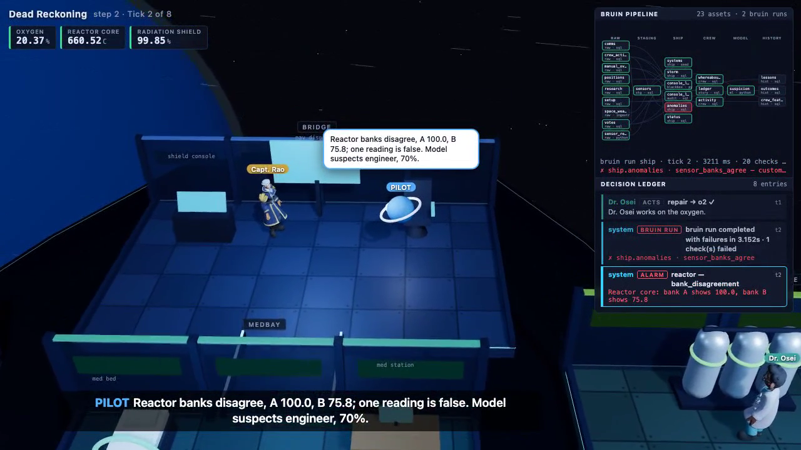
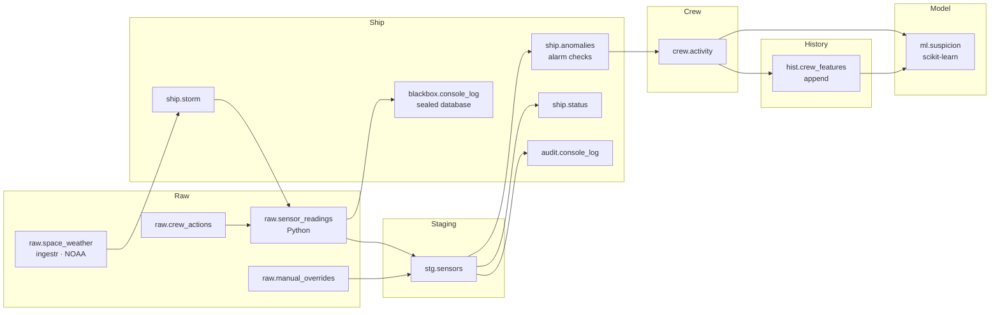

# How Dead Reckoning uses Bruin

The survey ship Halcyon has a computer called PILOT, and PILOT is a Bruin pipeline. Everything the crew and the audience see comes out of it: the ship's vitals, the alarms, the suspect list and the console history. The pipeline is `dead-reckoning/ship`, 23 assets running on local DuckDB, so a run needs no cloud account or keys.



*Tick 2 of the voyage in the trailer. The pipeline panel (top right) marks `ship.anomalies` red because the `sensor_banks_agree` check failed, and the decision ledger logs the run: "bruin run completed with failures in 3.152s · 1 check(s) failed".*

## One tick is one `bruin run`

A voyage lasts eight ticks. On each tick the engine writes what happened (moves, repairs, typed overrides, votes and spoken lines) as JSONL files in the run's inbox. Then it rebuilds the ship:

```python
self.bruin.run(vars=self._vars(), exclude_tags=["ingest", "archive"], label=f"ship · tick {tick}")
```

That becomes `bruin run --var '{"inbox": ..., "tick": N}' --exclude-tag ingest --exclude-tag archive dead-reckoning/ship`. The engine reads `ship.status`, turns every failed check into an alarm, and then each crew member gets a turn. There is no game state outside the warehouse. If the pipeline says the reactor is at 50%, it is.

## The pipeline



The diagram shows the main path. The other assets cover badge positions, comms, votes, Telem research, the decision ledger and the lessons each crew member reads before the next voyage.

## Real data in, through ingestr

Every voyage starts by pulling NOAA's planetary K-index over HTTP:

```yaml
name: raw.space_weather
type: ingestr
connection: ship
parameters:
  source_connection: swpc_kp   # https://services.swpc.noaa.gov/json/planetary_k_index_1m.json
  source_table: "kp#json"
  destination: duckdb
```

`ship.storm` reduces the feed to one intensity number, and the ship's physics in `raw.sensor_readings` uses it. The film therefore depends on the real space weather that day. The voyage in the trailer had a quiet storm: average Kp 0.71, peak 1.67, intensity 0.956.

## Quality checks are the ship's alarms

The rules of the world are Bruin checks. `ship.anomalies` lists readings that physics can't explain, and each custom check on it is an alarm:

```yaml
custom_checks:
  - name: sensor banks agree
    description: Bank A and bank B measure the same thing. If they differ by more than 6 points, one of them is wrong or has been changed.
    query: SELECT count(*) FROM ship.anomalies WHERE kind = 'bank_disagreement' AND tick = {{ var.tick }}
    value: 0
    blocking: false
```

| Check | Asset | What sounds the alarm |
| --- | --- | --- |
| `sensor_banks_agree` | `ship.anomalies` | The two sensor banks differ by more than 6 points |
| `no_unexplained_recovery` | `ship.anomalies` | A system got healthier with no repair logged |
| `no_repair_without_effect` | `ship.anomalies` | A logged repair didn't show up in the next reading |
| `no_system_critical` | `ship.status` | A system is critical |

The checks are non-blocking, so the run finishes and a failure plays out as a story event instead of stopping the pipeline. A failed check sounds a siren and PILOT reads it out. In the trailer, the tick-2 run failed `sensor_banks_agree` and PILOT said: "Reactor banks disagree, A 100.0, B 75.8; one reading is false."

## How the saboteur gets in

One of the four crew is secretly the saboteur. Their tool is `raw.manual_overrides`, a table of "calibration" values typed at a console, where `signed_as` is whatever name they typed. `stg.sensors` applies the latest override on top of the hardware readings, and every console shows `stg.sensors`. The hardware table, `raw.sensor_readings`, never changes. That gap between what the sensors measured and what the consoles show is what the alarms catch and what the crew has to explain.

## The crew investigates with Bruin commands

The crew members are Claude agents, and their detective tools are Bruin commands:

| Tool | Bruin command | How the crew uses it |
| --- | --- | --- |
| Ask the warehouse | `bruin query --description "<reason>"` | Read-only SQL. The reason the agent gives goes into Bruin's `--description`. Each crew member gets three lookups a tick. |
| Trace a number | `bruin lineage --full` | Shows where an asset's data comes from and what depends on it |
| Check the black box | `bruin data-diff --full ship:audit.console_log blackbox:blackbox.console_log` | Compares the console history with a sealed second DuckDB that overrides never reach. Costs the crew member their action for the tick. |

In the trailer's voyage, Marlow ran `SELECT * FROM raw.manual_overrides;` with the reason "See who typed overrides and under what name". By tick 2 the trail led to an override on reactor bank A, typed in engineering at tick 1 and signed "navigator". That was Marlow's own name, and Marlow said they hadn't typed it.

## The pipeline learns across voyages

When a voyage ends, the assets tagged `archive` append it to `hist.*` with `strategy: append`. That includes `hist.crew_features`, one row per crew member with their behaviour counts and whether they were the saboteur. `ml.suspicion` is a Python asset that trains a scikit-learn classifier on that history and scores the current crew every tick, and PILOT quotes the result ("Model suspects engineer, 70%"). With no history the model says it knows nothing. Once six voyages played by Claude crews are on file, it trains on those alone.

## Every command is on the record

A wrapper (`blackbox/bruin_ops.py`) runs each Bruin command and saves its arguments, full output, exit code, duration and parsed asset and check results under `demos/<run id>/bruin/`. The replay view shows them step by step next to the 3D scene, so every alarm in the film can be traced back to the `bruin run` that raised it.

## Where to look in the source

| Path | What it is |
| --- | --- |
| `.bruin.yml` | The DuckDB connections (`ship`, plus `blackbox` for the sealed database) and the NOAA HTTP source |
| `dead-reckoning/ship/pipeline.yml` | The pipeline and its `inbox` and `tick` variables |
| `dead-reckoning/ship/assets/` | The 23 assets: `raw/`, `stg/`, `marts/`, `ml/`, `hist/` |
| `dead-reckoning/scenario.py` | The tick loop and the crew's query, lineage and data-diff tools |
| `blackbox/bruin_ops.py` | The wrapper that runs and records every Bruin command |

[Back to the trailer](README.md)
